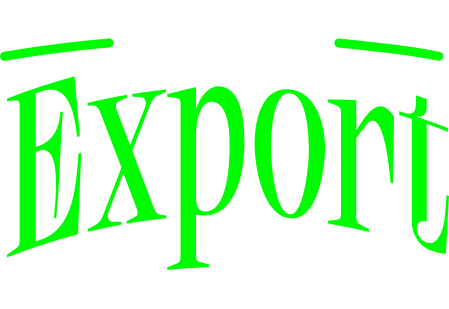

  

<h3 align="center">Plugin gratuito para Adobe Illustrator que arma el paquete completo de tu logo en segundos.</h3>

Por Edgar Quintero

  <a href="https://github.com/EDGARQUINTERO03/SUPEREXPORT-PLUGIN/archive/refs/heads/main.zip"><b>⬇️ DESCARGAR SUPEREXPORT</b></a>

---

## ✨ Qué hace

Exportar un logo en todos sus formatos y versiones de color, uno por uno, toma una eternidad. SuperExport lo hace por ti en 4 pasos:

**01 · Logos.** Selecciona cada versión de tu logo (horizontal, vertical, isotipo…), ponle nombre y agrégala. Cada una recibe su propia mesa de trabajo, ajustada a su forma exacta y ordenada en columnas.

**02 · Color.** Elige qué versiones de color van en el paquete:
- Original
- Negro
- Blanco (sobre fondo oscuro)
- Escala de grises
- Invertida
- Una versión por cada color de tu marca
- Esquemas propios

Puedes agregar los colores de la marca en HEX, con el selector o tomarlos directamente del logo. Todo se actualiza en vivo mientras ajustas.

**03 · Formatos.** Marca los que necesites:

| Formato | Para qué |
|---|---|
| **PDF** | Vectorial, para imprenta y para enviar |
| **AI** | Editable en Illustrator |
| **SVG** | Vectorial para web |
| **EPS** | Para imprentas y programas antiguos |
| **PNG** | Imagen con fondo transparente |
| **JPG** | Imagen con fondo de color (incluye fondos con los colores de la marca) |

Opcional: archivo maestro .ai con todas las mesas, un PDF con todas las versiones y textos convertidos a contornos.

**04 · Exportar.** Escribe el nombre de la marca, elige la carpeta y organiza el paquete **por logo** o **por formato**. Un clic y listo para enviar al cliente.

---

## 🛠 Instalación

Funciona con **Illustrator CC 2017 o posterior** en Windows y Mac.

### Windows
1. Cierra Illustrator.
2. Descarga y descomprime el .zip.
3. Haz doble clic en **`Instalar-Windows.bat`** y sigue las instrucciones.
4. Abre Illustrator y ve a **Ventana → Extensiones → Super Export**.

> Si Windows muestra un aviso de seguridad, haz clic en **Más información → Ejecutar de todas formas**.

### Mac
1. Cierra Illustrator.
2. Descarga y descomprime el .zip.
3. Haz **clic derecho** en **`Instalar-Mac.command`** → **Abrir** → **Abrir** (la primera vez macOS pide confirmar).
4. Abre Illustrator y ve a **Ventana → Extensiones → Super Export**.

<b>Instalación manual (si el instalador no funciona)</b>

1. **Windows:** haz doble clic en `Activar-paneles-Windows.reg` y acepta.
   **Mac:** en Terminal, ejecuta `for v in 9 10 11 12; do defaults write com.adobe.CSXS.$v PlayerDebugMode 1; done`
2. Copia la carpeta `com.superexport` en:
   - **Windows:** `%APPDATA%\Adobe\CEP\extensions\` (crea las carpetas `CEP` y `extensions` si no existen)
   - **Mac:** `~/Library/Application Support/Adobe/CEP/extensions/`
3. Reinicia Illustrator.

---

## 🔄 Actualizaciones

Cuando salga una versión nueva, descarga de nuevo el .zip desde el botón de arriba (siempre trae la última versión) y vuelve a ejecutar el instalador. Tus logos registrados, esquemas y colores de marca se conservan.

Las novedades de cada versión están en [CAMBIOS.md](CAMBIOS.md).

---

## ❓ Problemas frecuentes

- **No aparece en Ventana → Extensiones:** cierra Illustrator por completo, ejecuta el instalador otra vez y vuelve a abrirlo.
- **¿Tenías LogoPack (la versión anterior)?** El instalador la reemplaza automáticamente y tus logos se siguen reconociendo.
- ¿Otro problema? Abre un [issue](https://github.com/EDGARQUINTERO03/SUPEREXPORT-PLUGIN/issues).

---

## 📄 Licencia

Gratis para usar en proyectos personales y comerciales. No está permitido venderlo ni redistribuirlo como propio. Detalles en [LICENSE](LICENSE.md).

© 2026 Edgar Quintero
